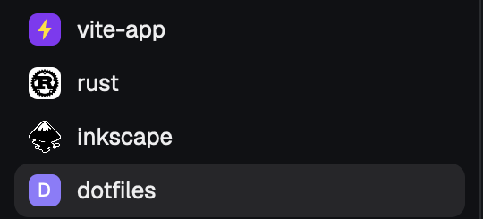

# space-favicons

A [Herdr](https://herdr.dev) mod that gives every space in the sidebar its project's own icon.



## Where the icon comes from

The first match wins:

1. An image you set yourself with **Set icon…** in the space's right-click menu.
2. `space-icons/<repo>.<png|jpg|jpeg|gif|webp|svg>` in `~/.config/herdr-app/`, named after the repo.
3. **The project's favicon**: `favicon*`, `icon.*` or `apple-touch-icon*` at any depth in the repo (git's own file list, so `node_modules` and ignored folders are skipped). A favicon nearer the root beats a deeper one, and SVG beats PNG. `.ico` files are converted to PNG with `sips` (macOS).
4. **The picture the git host shows** for `origin` (else the first remote):

   | Host | Picture |
   |---|---|
   | GitHub | the owner's avatar |
   | GitLab | the project's avatar, else its group's |
   | Bitbucket | the repository's avatar |
   | Codeberg, Gitea, Forgejo | the repository's avatar, else the owner's |
   | Gitee | the owner's avatar |

5. The usual colored letter tile.

## Install

Copy the mod folder into your Herdr app home and point your layout at it:

```sh
git clone https://github.com/JustRixter/space-favicons
cp -R space-favicons/mods/space-favicons ~/.config/herdr-app/mods/
herdr-app check ~/.config/herdr-app/mods/space-favicons
```

Herdr's own layouts are read-only, so clone one and use the clone:

```sh
herdr-app do layout.clone '{"name":"main","as":"my-main"}'
```

Then edit `~/.config/herdr-app/layouts/my-main.json` and set the Spaces block's `content.mod` to `space-favicons`. The window follows within a second.

## What it runs and fetches

Read this before installing.

- It runs `sh`, `git`, `find`, `grep`, `cksum`, `cp`, `curl`, `file` and, on macOS, `sips`.
- For a project with no favicon, it makes one request to its git host's public API or avatar URL. The request contains only the repository path from your remote. Fetched pictures are kept for a week.
- It copies favicons and pictures into `~/.config/herdr-app/data/space-favicons/auto/`, because Herdr only reads images under its app folder.
- Nothing is sent anywhere else.

## Limits

- Every repo under the same GitHub owner shows the same picture, because GitHub has no per-repo image.
- SourceHut, Azure DevOps and self-hosted servers without `gitlab`, `gitea`, `forgejo`, `bitbucket` or `gitee` in the hostname have no avatar to ask for. Private projects can't be asked either. These show the letter tile.
- Spaces on another machine only get the letter tile, because their files aren't copied.
- On Windows the favicon and host steps are skipped.

## License

Apache-2.0, see [LICENSE](LICENSE) and [NOTICE](NOTICE). Derived from the `spaces` mod shipped with the Herdr app. `RECIPE.md` is the brief for rebuilding it from scratch.
