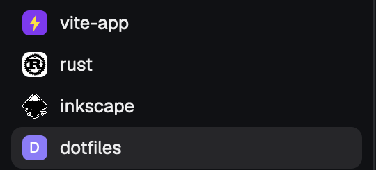

# Space favicons

A replacement for Herdr's Spaces sidebar where every space wears its project's own icon: the favicon found in its checkout, else the picture its git host shows for the repo (GitHub, GitLab, Bitbucket, Codeberg and other Gitea/Forgejo hosts, Gitee), else the usual colored letter.

## What you see

The Spaces list as in the shipped `spaces` mod: stable colored avatars, worktree spaces nested under their repo, branch and ahead/behind on the right. Each avatar is an 18 px rounded square (radius 5) in front of the space name. It shows, first match wins:

1. an image the person set with the space menu's **Set icon…**
2. `space-icons/<repo>.<png|jpg|jpeg|gif|webp|svg>` in the app folder, named after the repo
3. the project's favicon
4. the picture the `origin` remote's host shows (else the first remote's): GitHub the owner's avatar; GitLab, Bitbucket, Codeberg/Gitea/Forgejo the repository's avatar, else its group's or owner's; Gitee the owner's avatar
5. the first letter of the space name, white, bold, 10.5 px, on the colored tile

## How it behaves

- Agent state is not drawn here; the agents list shows it. Click selects a space, right-click opens this mod's own space menu (with Set icon… / remove), drag reorders within a machine.
- The favicon is looked for when a space appears, when its folder changes, when a command or agent turn ends, and about every minute while the window is in front.
- In a git repo the search lists tracked and untracked-but-not-ignored files at any depth, plus nested checkouts up to three folders down. Outside a repo it searches eight folders down, skipping `node_modules`, `dist`, `build`, `target`, `vendor`, `.next`, `.venv` and `.git`.
- Matching names: `favicon*`, `icon.<ext>`, `apple-touch-icon*` with svg, png, ico, webp, jpg, jpeg or gif. Ranking: fewer folders deep first, then `favicon.<ext>` before `favicon-32x32.png` before `icon.<ext>` before `apple-touch-icon*`, then svg, png, webp, jpg, gif, ico, then the shorter path.
- An `.ico` is converted to PNG with macOS `sips`; elsewhere `.ico` is ignored.
- SourceHut, Azure DevOps and self-hosted hosts whose name lacks `gitlab`, `gitea`, `forgejo`, `bitbucket` or `gitee` have no avatar to ask for, and private projects can't be asked: they show the letter. A fetched picture is kept for a week, then fetched again.
- Spaces on another machine never get a favicon or a host picture (their files are not copied); they show the letter. On Windows the favicon and host steps are skipped.

## Built from

- `mods/space-favicons/main.js`: a copy of Herdr's `spaces` mod (0.1.11) whose default export draws the sidebar, or the menu or dialog when `props().view` is `"menu"` / `"pick"`. Its `findIcon(key, cwd, cx)` runs from `check()` for local places only and fills `this.auto[where()]`; `row()` uses `resolveIcon(...) ?? auto`.
- `autoicon.js`: `FIND_SCRIPT`, `COPY_SCRIPT`, `REMOTE_SCRIPT` (run with `exec("sh", ["-c", script, "_", ...args])`) and `pickFavicon`, `copyExt`, `copyPath`.
- `avatars.js`, `files.js`, `menu.js`, `pick.js`: the Set icon… menu and dialog; picked images are copied to `data/space-favicons/` and mapped in `shared("space-favicons.icons")`.
- `image.svg`: the menu icon.
- Favicon copies go to `data/space-favicons/auto/<cksum>-<size>.<ext>` (`image()` only reads under the app folder). Host pictures go to `data/space-favicons/auto/gh-<owner>.<ext>` (GitHub, from `https://github.com/<owner>.png?size=64`) or `rp-<checksum>.<ext>` (the others, from the host's public API: `/api/v4/projects/<path>`, `api.bitbucket.org/2.0/repositories/<path>`, `/api/v1/repos/<path>`, `gitee.com/api/v5/repos/<path>`), fetched with `curl`.
- `mod.json`: `{"place":"none"}`. Use it from a layout: set the Spaces block's `content.mod` to `space-favicons`, e.g. clone `main` with `layout.clone` and edit the clone.

## Watch out

- It runs `sh`, `git`, `cksum`, `cp`, `curl`, `file` and (macOS) `sips`, and, for a project with no favicon, makes a request to its git host's public API or avatar URL, containing only the repository path from `origin`. Tell the person before installing.
- Every repo of the same GitHub owner shows the same picture (GitHub has no per-repo picture).
- `image()` only reads files under the app folder, so nothing may point at a path outside it.
- Never keep a `cx` for later; every callback gets its own.
- The mod keeps the shipped `spaces` look as of 0.1.11; a newer Herdr may change that mod.

## Done when

- `herdr-app check ~/.config/herdr-app/mods/space-favicons` passes.
- A space in a repo with `public/favicon.svg` shows that image; deleting the file makes it fall back within a minute.
- A repo with a GitHub, GitLab, Bitbucket, Codeberg or Gitee `origin` and no favicon shows that host's picture; a repo on another host (SourceHut) or a plain folder shows its letter.
- A favicon five folders down in a monorepo is found.
- Set icon… on a space overrides all of the above, and removing it brings the automatic icon back.
